<picture>
  <source media="(prefers-color-scheme: dark)" srcset="header-dark.svg">
  
</picture>

I sit between pre-sales architecture and hands-on delivery. I scope the problem with the client, build the agent, write the evals, and stay until it runs in production. 14 years across enterprise software, airline network planning and pricing technology before LLMs, which is most of why I know what a client's ops team will push back on.

Currently an AI Solutions Architect at [DevRev](https://devrev.ai), working with enterprise clients across India and APJ. Based in Gurugram.

## What I build

- **Agentic systems with explicit control flow.** State machines with typed model outputs, so a risk team can read which step does what and the tests can prove the agent never skips one.
- **Grounding checks that don't depend on a second model.** Every claim in an agent's output traced to a source record, checked in code, before it reaches a customer or a case file.
- **The parts around the model.** Discovery, success criteria in the SOW, shadow-mode rollouts, monitoring for when a data source goes stale.

Production work so far includes customer operations agents for a large airline, a fraud investigation agent piloted at a bank, and agent workstreams for a large fintech. That code belongs to clients. The patterns are public below.

## Start here

**[grounded-triage](https://github.com/shahabajsk/grounded-triage)**: a state-machine agent for bank card-dispute triage, with a verifier that holds unverified claims shipped at zero under 40% injected fabrication. Python agent and eval harness, React and TypeScript console, ADRs, and the discovery and deployment docs I'd use at a client. [Live dashboard](https://shahabajsk.github.io/grounded-triage/).

Earlier: I built **Legit.ai**, a multi-model AI platform for lawyers, and took it to paying customers. It didn't raise. The code is private; I'm happy to walk through the architecture and what I'd do differently.

## Tools I reach for

Python, TypeScript, React, Node.js · Claude and other LLM APIs · Pydantic, pytest · LightGBM for forecasting work · GitHub Actions

## Contact

[LinkedIn](https://www.linkedin.com/in/shahabaj) · shahabaj.sheikh@gmail.com
