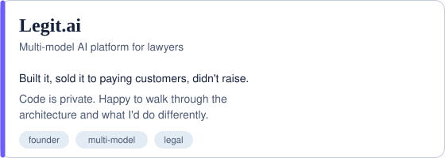

<picture>
  <source media="(prefers-color-scheme: dark)" srcset="header-dark.svg">
  
</picture>

<picture>
  <source media="(prefers-color-scheme: dark)" srcset="metrics-dark.svg">
  
</picture>

<table>
  <tr>
    <td width="50%" valign="top">
      <picture>
        <source media="(prefers-color-scheme: dark)" srcset="about-dark.svg">
        
      </picture>
    </td>
    <td width="50%" valign="top">
      <a href="https://github.com/shahabajsk/grounded-triage">
        <picture>
          <source media="(prefers-color-scheme: dark)" srcset="card-triage-dark.svg">
          
        </picture>
      </a>
      <picture>
        <source media="(prefers-color-scheme: dark)" srcset="card-legit-dark.svg">
        
      </picture>
    </td>
  </tr>
</table>

## Where I've worked

Airline, banking and other industries. Client names stay out; the patterns are public.

<picture>
  <source media="(prefers-color-scheme: dark)" srcset="industries-dark.svg">
  
</picture>

## What I build

- **Agents with explicit control flow.** State machines with typed model outputs, so a risk team can read which step does what, and the tests can prove the agent never skips one.
- **Grounding checks that don't depend on a second model.** Every value in an agent's output traced to a source record and checked in code before it reaches a customer or a case file.
- **The parts around the model.** Discovery, success criteria written into the SOW, shadow-mode rollouts, and monitoring for when a data source goes stale.

Client code belongs to clients. The patterns are public in [grounded-triage](https://github.com/shahabajsk/grounded-triage).

<picture>
  <source media="(prefers-color-scheme: dark)" srcset="divider-dark.svg">
  
</picture>

## What happens when the model makes something up

Under 40% injected fabrication, the verifier rejects every bad draft. When a draft can't be fixed, nothing ships and the case goes to a human:

<picture>
  <source media="(prefers-color-scheme: dark)" srcset="terminal-dark.svg">
  
</picture>

## How I run an engagement

<picture>
  <source media="(prefers-color-scheme: dark)" srcset="phases-dark.svg">
  
</picture>

## Stack

<picture>
  <source media="(prefers-color-scheme: dark)" srcset="stack-dark.svg">
  
</picture>

Before LLMs: 14 years across enterprise software, airline operations planning and pricing technology, at Deloitte, TCS, Sabre, RPost, RateGain, an airline, and now DevRev.

Every visual on this page is hand-written SVG, generated by [build_svgs.py](build_svgs.py) from real traces and eval numbers. No third-party widgets to break.
