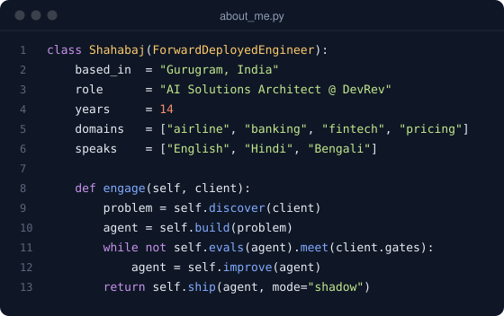
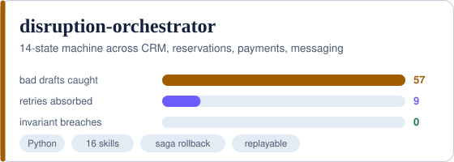
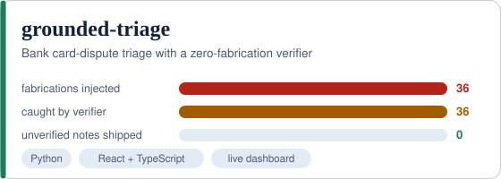
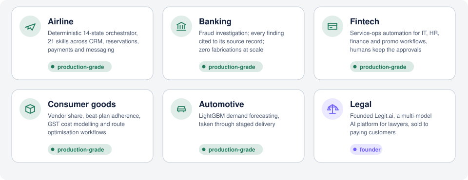

<picture>
  <source media="(prefers-color-scheme: dark)" srcset="header-dark.svg">
  
</picture>

[](https://www.linkedin.com/in/shahabaj)
[](mailto:shahabaj.sheikh@gmail.com)
[](https://shahabajsk.github.io/grounded-triage/)
[](https://shahabajsk.github.io/disruption-orchestrator/)

<picture>
  <source media="(prefers-color-scheme: dark)" srcset="metrics-dark.svg">
  
</picture>

<table>
  <tr>
    <td width="50%" valign="top">
      <picture>
        <source media="(prefers-color-scheme: dark)" srcset="about-dark.svg">
        
      </picture>
    </td>
    <td width="50%" valign="top">
      <a href="https://github.com/shahabajsk/disruption-orchestrator">
        <picture>
          <source media="(prefers-color-scheme: dark)" srcset="card-orch-dark.svg">
          
        </picture>
      </a>
      <a href="https://github.com/shahabajsk/grounded-triage">
        <picture>
          <source media="(prefers-color-scheme: dark)" srcset="card-triage-dark.svg">
          
        </picture>
      </a>
    </td>
  </tr>
</table>

## Where I've worked

Production-grade AI systems in airline, banking, fintech, consumer goods, automotive and legal. Client names stay out.

<picture>
  <source media="(prefers-color-scheme: dark)" srcset="industries-dark.svg">
  
</picture>

## Highlights

<picture>
  <source media="(prefers-color-scheme: dark)" srcset="highlights-dark.svg">
  
</picture>

<details>
<summary><b>Read the highlights as text</b></summary>

- **Airline.** Architected and own delivery of a deterministic 14-state orchestrator that runs customer operations end to end. It coordinates 21 skills across CRM, reservations, payments and messaging, and every transition is explicit and testable. Adoption peaked, and the airline consolidated its resolution work on the platform.
- **Banking.** Built a fraud investigation system where every finding cites the transaction record it came from, and deterministic verification blocks anything uncited. Under adversarial QA it passed 46 of 50 cases, with zero fabrications across thousands of transactions.
- **Fintech.** Designed service-operations automation for IT, HR, finance and promo workflows on one platform of record. Automation acts where policy already decides the outcome; every other approval stays with a human.
- **Consumer goods.** Designed AI workflows for vendor share-of-business, beat-plan adherence, GST cost modelling and route optimisation.
- **Automotive.** Built a LightGBM demand forecasting model and took it through staged delivery.
- **Founder.** Built Legit.ai, a multi-model AI platform for lawyers, and sold it to paying customers.
- **Speaking.** Ran "Who Owns the Outcome? Leading When Your Newest Team Member Is an AI" for RateGain's NorthStar 2.0 first-manager programme.

</details>

## What I build

Agents that a risk team can read and a test suite can hold to account. Each panel replays a real trace from [disruption-orchestrator](https://github.com/shahabajsk/disruption-orchestrator); the numbers come from its eval of 98 contacts.

<picture>
  <source media="(prefers-color-scheme: dark)" srcset="build-dark.svg">
  
</picture>

<details>
<summary><b>See the code behind each panel</b></summary>

**01 · Each state allowlists its skills.** A refund can only run in the refund state.

```python
def run(self, skill_name: str, allowed: frozenset[str], fn: Callable[[], object]) -> object:
    if skill_name not in allowed:
        raise SkillNotAllowed(skill_name)
```

**02 · Flight codes and amounts in an outbound message must come from the case facts.**

```python
def ungrounded(body: str, facts: dict) -> list[str]:
    known = {str(v) for v in facts.values()} | {f"{v:,}" for v in facts.values() if isinstance(v, int)}
    issues = [f for f in FLIGHT.findall(body) if f not in known]
    issues += [a for a in AMOUNT.findall(body) if a not in known and a.replace(",", "") not in known]
    return issues
```

**03 · A retried refund with the same key returns the first result.**

```python
def refund(self, idempotency_key: str, pnr: str, amount: int) -> Payment:
    if idempotency_key in self.ledger:
        return self.ledger[idempotency_key]
    self.faults.check("pay.refund")
    p = Payment(id=f"PAY-{len(self.ledger) + 1:04d}", pnr=pnr, amount=amount, kind="refund")
    self.ledger[idempotency_key] = p
    self.faults.after_commit("pay.refund")  # test hook: commit, then time out
    return p
```

</details>

Client code belongs to clients. The patterns are public: [disruption-orchestrator](https://github.com/shahabajsk/disruption-orchestrator) for multi-system orchestration, [grounded-triage](https://github.com/shahabajsk/grounded-triage) for zero-fabrication verification.

<picture>
  <source media="(prefers-color-scheme: dark)" srcset="divider-dark.svg">
  
</picture>

## What happens when the model makes something up

Under 40% injected fabrication, the verifier rejects every bad draft. When a draft can't be fixed, nothing ships and the case goes to a human:

<picture>
  <source media="(prefers-color-scheme: dark)" srcset="terminal-dark.svg">
  
</picture>

## How I run an engagement

<picture>
  <source media="(prefers-color-scheme: dark)" srcset="phases-dark.svg">
  
</picture>

## Stack

<picture>
  <source media="(prefers-color-scheme: dark)" srcset="stack-dark.svg">
  
</picture>

Before LLMs: 14 years across enterprise software, airline operations planning and pricing technology, at Deloitte, TCS, Sabre, RPost, RateGain, an airline, and now DevRev.

<sub>Every visual on this page is hand-written SVG, generated by [build_svgs.py](build_svgs.py) from real traces and eval numbers. No third-party widgets to break.</sub>
