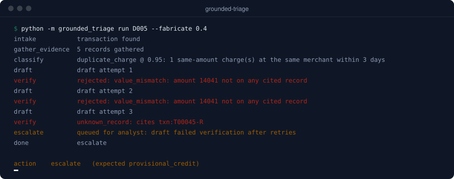

<picture>
  <source media="(prefers-color-scheme: dark)" srcset="header-dark.svg">
  
</picture>

I sit between pre-sales architecture and hands-on delivery. I scope the problem with the client, build the agent, write the evals, and stay until it runs in production. Currently an AI Solutions Architect at [DevRev](https://devrev.ai), working with enterprise clients across India and APJ.

## What I build

- **Agents with explicit control flow.** State machines with typed model outputs, so a risk team can read which step does what, and the tests can prove the agent never skips one.
- **Grounding checks that don't depend on a second model.** Every value in an agent's output traced to a source record and checked in code before it reaches a customer or a case file.
- **The parts around the model.** Discovery, success criteria written into the SOW, shadow-mode rollouts, and monitoring for when a data source goes stale.

Production work so far includes customer operations agents for a large airline, a fraud investigation agent piloted at a bank, and agent workstreams for a large fintech. That code belongs to clients. The patterns are public below.

## Start here: [grounded-triage](https://github.com/shahabajsk/grounded-triage)

A state-machine agent for bank card-dispute triage. Under 40% injected fabrication, the verifier catches 36 of 36 bad drafts and ships zero unverified notes. When a draft can't be fixed, the case goes to a human instead:

<picture>
  <source media="(prefers-color-scheme: dark)" srcset="terminal-dark.svg">
  
</picture>

Python agent and eval harness, a React and TypeScript console ([live](https://shahabajsk.github.io/grounded-triage/)), three ADRs, and the discovery and deployment docs I'd bring to a client.

## How I run an engagement

<picture>
  <source media="(prefers-color-scheme: dark)" srcset="phases-dark.svg">
  
</picture>

## Before this

14 years across enterprise software, airline network planning and pricing technology, at Deloitte, TCS, IndiGo, Sabre, RPost, RateGain and now DevRev. That's most of why I know what a client's ops team will push back on.

I also built **Legit.ai**, a multi-model AI platform for lawyers, and took it to paying customers. It didn't raise. The code is private; I'm happy to walk through the architecture and what I'd do differently.

## Stack

The animations on this page are hand-written SVG, generated by [build_svgs.py](build_svgs.py) from real traces. No third-party widgets.
